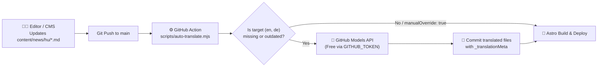
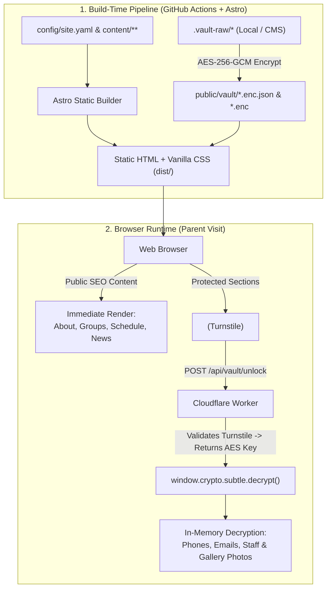

# Architecture & Technical Design

This document describes the technical architecture of **OpenCreche**, explaining how it achieves a fast, warm, multilingual, and scrape-resistant website for nurseries and kindergartens using 100% free infrastructure.

---

## 1. Design Philosophy

1. **Zero Monthly Cost:** Nurseries and kindergartens often operate on tight budgets. Every component of OpenCreche runs comfortably within the free tiers of GitHub Pages, Cloudflare (DNS, Turnstile, Workers), and Resend.
2. **Human, Non-AI Aesthetic:** Most modern templates rely on React + Tailwind + shadcn/ui, resulting in cold, generic SaaS interfaces ("AI-slop"). OpenCreche uses **Astro** with **semantic HTML and pure Vanilla CSS** utilizing warm earth/pastel palettes, organic SVG dividers, tactile card borders, and playful yet legible typography.
3. **Privacy by Default (Public Repo Safe):** Because GitHub Free requires a **public repository** for GitHub Pages, no raw sensitive data (phone numbers, staff photos, children's gallery photos) is ever stored in plaintext in the Git repository or the compiled HTML.
4. **Config-First & Non-Technical Friendly:** Everything is driven by structured YAML and Markdown files, editable either directly in Git or through an integrated Git-based visual Admin UI (**Sveltia CMS**).

---

## 2. Technology Stack

| Layer | Technology | Rationale |
| :--- | :--- | :--- |
| **Static Site Generator** | [Astro](https://astro.build/) | Zero JS by default, built-in i18n routing, type-safe Content Collections (Zod), fast builds. |
| **Styling** | Vanilla CSS (Custom Properties + Modern CSS) | Complete control over organic shapes, fluid typography (`clamp()`), and warm themes without utility-class bloat or SaaS clichés. |
| **Client Interactivity** | Vanilla TypeScript + Web Components | Lightweight custom elements (`<privacy-vault>`, `<encrypted-img>`, `<contact-form>`) using native browser `crypto.subtle` (WebCrypto API). |
| **Bot Protection** | [Cloudflare Turnstile](https://www.cloudflare.com/products/turnstile/) | Free, privacy-preserving CAPTCHA replacement that verifies human visitors without annoying puzzle grids. |
| **Serverless Backend** | [Cloudflare Workers](https://workers.cloudflare.com/) (Free Tier: 100k req/day) | Verifies Turnstile tokens, releases decryption keys, processes contact form submissions, and handles GitHub OAuth for the CMS. |
| **Email Delivery** | [Resend API](https://resend.com/) / Cloudflare Email | Free tier (3,000 emails/month, 100/day) called directly from the Cloudflare Worker via HTTP `fetch`. |
| **Visual Admin UI** | [Sveltia CMS](https://github.com/sveltia/sveltia-cms) | Drop-in, fast, modern replacement for Decap/Netlify CMS with native i18n support, stored as a single static `/admin/index.html` page. |

---

## 3. Repository Directory Structure

```text
open-creche/
├── .github/
│   └── workflows/
│       └── deploy.yml              # GitHub Action: Auto-translate, build & deploy to Pages
├── config/
│   ├── site.yaml                   # Global settings (domain, languages, theme, worker URL)
│   └── navigation.yaml             # Multilingual header/footer links
├── content/
│   ├── i18n/                       # UI string translations
│   │   ├── en.yaml
│   │   ├── hu.yaml
│   │   └── de.yaml
│   ├── pages/                      # Core institutional content per language
│   │   ├── en/
│   │   │   ├── about.md            # Introduction & pedagogical philosophy
│   │   │   └── schedule.yaml       # Daily routine and meal schedule
│   │   ├── hu/
│   │   │   ├── about.md
│   │   │   └── schedule.yaml
│   │   └── de/
│   │       ├── about.md
│   │       └── schedule.yaml
│   ├── groups/                     # Creche/Kindergarten groups (rooms)
│   │   ├── en/
│   │   ├── hu/
│   │   └── de/
│   ├── news/                       # Multilingual news & events calendar entries
│   │   ├── en/
│   │   ├── hu/
│   │   └── de/
│   └── vault/                      # Encrypted data manifests (committed to Git)
│       ├── contact.enc.json        # AES-256-GCM encrypted phone numbers & emails
│       ├── staff.enc.json          # AES-256-GCM encrypted staff bios & photo refs
│       └── gallery.enc.json        # AES-256-GCM encrypted gallery metadata
├── public/
│   ├── assets/                     # Public logos, decorative illustrations, icons
│   ├── vault-media/                # Encrypted binary blobs (*.enc) for staff & gallery photos
│   └── admin/                      # Sveltia CMS static entry + pre-commit encryption hook
│       ├── index.html
│       └── config.yml
├── scripts/
│   ├── auto-translate.mjs          # Free AI translator via GitHub Models + fallback
│   ├── vault-cli.mjs               # CLI tool to encrypt/decrypt local files in `.vault-raw/`
│   └── generate-keys.mjs           # Helper to generate AES-256 master key
├── src/
│   ├── components/
│   │   ├── layout/                 # Header, Footer, LanguageSwitcher, WaveDivider
│   │   ├── sections/               # Hero, About, DailySchedule, Groups, NewsCalendar
│   │   └── vault/                  # TurnstileGate, ProtectedContact, ProtectedStaff, ProtectedGallery
│   ├── layouts/
│   │   └── BaseLayout.astro
│   ├── pages/
│   │   ├── index.astro             # Root language redirector / default locale
│   │   └── [lang]/
│   │       ├── index.astro         # Main landing page per language
│   │       ├── news/
│   │       │   ├── index.astro
│   │       │   └── [slug].astro
│   │       └── gallery.astro
│   ├── styles/
│   │   ├── tokens.css              # Design tokens (colors, spacing, fonts, organic radii)
│   │   ├── base.css                # Reset & typography
│   │   └── components.css          # Tactile, craft-style component styling
│   └── utils/
│       ├── i18n.ts
│       └── crypto-client.ts        # Browser WebCrypto AES-GCM decryption helpers
├── worker/                         # Standalone Cloudflare Worker project
│   ├── wrangler.toml
│   └── src/
│       ├── index.ts                # Router
│       ├── turnstile.ts            # Cloudflare Turnstile siteverify validator
│       ├── vault-key.ts            # Issues decryption key upon valid Turnstile token
│       ├── contact.ts              # Sends email via Resend API
│       └── oauth.ts                # GitHub OAuth proxy for Sveltia CMS
└── .vault-raw/                     # GIT-IGNORED folder for local plaintext editing before encryption
```

---

## 4. Multilingual (i18n) & Automated Translation Architecture

OpenCreche supports multiple languages (`en`, `hu`, `de` by default) using Astro's native i18n routing:

- **URL Structure:**
  - `/hu/` (or `/` if `defaultLocale: "hu"` with `prefixDefaultLocale: false`)
  - `/en/`
  - `/de/`
- **Two Layers of Translation:**
  1. **UI Dictionary (`content/i18n/{lang}.yaml`):** Button labels, section headings, privacy gate prompts, form labels, and error messages.
  2. **Content Collections (`content/{collection}/{lang}/*`):** Rich Markdown and YAML content for groups, daily schedules, news, and pedagogical introductions.

### Automated AI Translation Pipeline (GitHub Actions)
To prevent nursery staff from having to manually translate every announcement or schedule update into multiple languages, OpenCreche includes `scripts/auto-translate.mjs` executed automatically in GitHub Actions:

1. **Zero-Key Default Provider (GitHub Models):**
   - Uses GitHub's built-in **GitHub Models inference endpoint** (`https://models.inference.ai.azure.com`) authenticated via the workflow's native `GITHUB_TOKEN` (`permissions: models: read, contents: write`).
   - Requires zero external API keys or paid subscriptions.
   - Supports optional fallback providers (**Cloudflare Workers AI** or **Google Gemini Free Tier**) if configured via repository secrets.
2. **Smart Change Detection (`_translationMeta`):**
   - When an editor creates or updates a file in the `defaultLocale` (e.g., `content/news/hu/2026-tavaszi-nyilt-nap.md`), `scripts/auto-translate.mjs` computes a SHA-256 hash of the source content (`sourceHash`).
   - For each target locale configured in `config/site.yaml` (e.g., `en`, `de`), it checks if the corresponding file exists and whether its `_translationMeta.sourceHash` matches the current source file.
   - If the target file is missing or outdated—and does not have `_translationMeta.manualOverride: true`—the script translates the YAML/Markdown content while strictly preserving keys, dates, icons, and formatting.
### Commit-Back Workflow
- The GitHub Action commits the newly generated or updated translation files directly back to the repository (`chore(i18n): auto-translate content [skip ci]`) before building and deploying the Astro site to GitHub Pages.
- Because translations are committed to Git, staff can review or manually refine any translation in the `/admin` CMS at any time.



---

## 5. Styling & Visual Identity ("Anti-AI-Slop")

To ensure the website feels welcoming to parents and authentic to a childcare institution:

- **Color Palettes (`src/styles/tokens.css`):**
  - Instead of stark white (`#ffffff`) and neon blue/purple gradients, OpenCreche uses warm paper backgrounds (`#FAF6F0`, `#F3ECE1`), terracotta (`#D96B43`), sage green (`#6B9080`), mustard yellow (`#E6B84C`), and deep charcoal-brown (`#2C2523`) for high-contrast readable text.
  - Multiple pre-built themes (`meadow`, `sunshine`, `forest`, `terracotta`) selectable via `config/site.yaml`.
- **Organic Geometry:**
  - Asymmetric border radii (e.g., `border-radius: 24px 32px 20px 28px`) that mimic hand-cut paper or pebbles.
  - Hand-drawn style SVG section dividers (waves, clouds, hills, leaves) between page sections.
- **Typography:**
  - Friendly, rounded headings (e.g., *Fraunces*, *Nunito*, or *Quicksand* self-hosted via variable WOFF2 fonts—zero Google Fonts tracking requests) paired with clean, highly legible body text (*Plus Jakarta Sans* or *Atkinson Hyperlegible*).

---

## 6. Component Data Flow



### Public Content Flow (Build Time)
1. Astro reads `config/site.yaml` and `content/**`.
2. Astro validates schemas using Zod.
3. Static HTML pages (`/hu/index.html`, `/en/index.html`, `/de/index.html`) are generated and deployed to GitHub Pages.
4. Search engines index the institution's name, general location (city/district), pedagogical program, daily routine, and public news—providing strong local SEO while exposing zero personal data.

### Protected Content Flow (Runtime in Browser)
1. A parent clicks **"Show Phone Number & Email"**, **"View Staff"**, or **"Unlock Photo Gallery"**.
2. The `<privacy-vault>` Web Component renders a **Cloudflare Turnstile** widget.
3. Upon passing the challenge, the browser sends the Turnstile token to the Cloudflare Worker (`POST /api/vault/unlock`).
4. The Cloudflare Worker validates the token with Cloudflare's `siteverify` API and returns the **AES-256-GCM decryption key** (and stores a short-lived token in `sessionStorage` so the parent only verifies once per visit).
5. The browser fetches `/vault/contact.enc.json` or `/vault-media/photo-01.enc` from GitHub Pages and decrypts it in-memory using `window.crypto.subtle.decrypt()`.
6. Images are rendered via temporary `URL.createObjectURL(blob)` URLs; phone numbers and emails are injected into the DOM.
