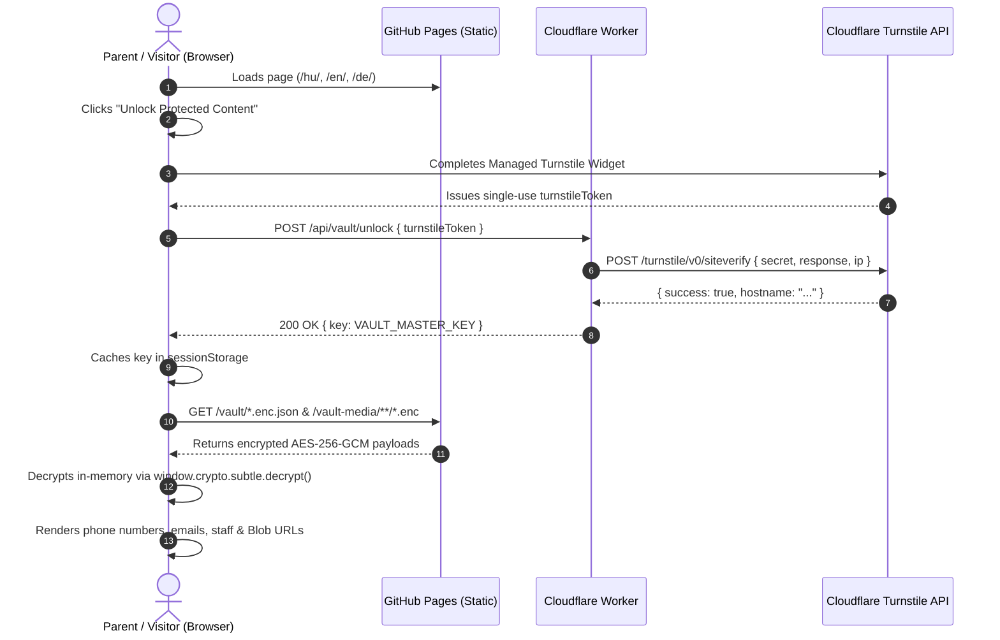

# Security & Anti-Scrape Privacy Vault

Nurseries and kindergartens handle highly sensitive information: direct phone numbers of caregivers, institutional email addresses, staff identities/portraits, and photos of children/events.

At the same time, hosting for free on **GitHub Pages (GitHub Free tier)** requires the repository to be **Public**, and all files served by GitHub Pages are publicly reachable via static URLs.

This document explains how **OpenCreche** resolves this paradox using a **Zero-Plaintext Git Vault (`AES-256-GCM`)** combined with **Cloudflare Turnstile** and a **Cloudflare Worker**.

---

## 1. Threat Model

| Threat | What Happens on Normal Static Sites | How OpenCreche Prevents It |
| :--- | :--- | :--- |
| **Email & Phone Harvesters** | Bots regex-scan HTML or decode simple Base64/`mailto:` links for spam and robocalls. | Contact data is encrypted with `AES-256-GCM`. Plaintext does not exist anywhere in the HTML, JS bundle, or Git repo. |
| **AI Image Scrapers & Crawlers** | Bots crawl `/assets/*.jpg` or inspect the public GitHub repository to harvest staff and children's photos. | Only encrypted binary files (`*.enc`) exist in the Git repo and on GitHub Pages. Without a valid Turnstile token verified by Cloudflare, the bytes are mathematically indistinguishable from random noise. |
| **Automated Form Spam** | Public `mailto:` or unprotected endpoints flood the kindergarten director's inbox. | Contact form submissions go exclusively through the Cloudflare Worker, which validates a single-use Turnstile token and enforces rate limiting before calling the Resend API. |
| **Git History Scraping** | Someone clones the public GitHub repository to look for raw photos or phone numbers. | Raw files reside in `.vault-raw/` (strictly `.gitignore`d) or are encrypted in-memory inside the browser CMS before committing to GitHub. |

---

## 2. Cryptographic Specification

- **Algorithm:** `AES-256-GCM` (Authenticated Encryption with Associated Data, natively supported by Node.js `crypto` and Browser `window.crypto.subtle`).
- **Master Key (`VAULT_MASTER_KEY`):** A 256-bit (32-byte, 64-character hex or Base64) secret generated once per institution (`npm run vault:init`).
  - Stored locally in `.env` (gitignored) for CLI encryption.
  - Stored as an encrypted Cloudflare Worker Secret (`wrangler secret put VAULT_MASTER_KEY`).
- **Initialization Vector (IV):** A fresh 96-bit (12-byte) cryptographically random IV is generated for every single encrypted file or JSON payload.
- **Binary File Format (`*.enc` for Photos):**
  ```mermaid
  packet-beta
    0-11: "12 Bytes: Random IV (96-bit)"
    12-43: "N Bytes: AES-256-GCM Ciphertext (WebP/SVG)"
    44-59: "16 Bytes: GCM Auth Tag (128-bit)"
  ```
- **JSON Manifest Format (`*.enc.json` for Contact, Staff & Gallery Metadata):**
  ```json
  {
    "version": 1,
    "alg": "AES-256-GCM",
    "iv": "base64-encoded-12-byte-iv",
    "ciphertext": "base64-encoded-ciphertext-with-auth-tag"
  }
  ```

---

## 3. End-to-End Unlock Flow



### Single-Verification UX (Parent-Friendly)
Parents do **not** have to solve a CAPTCHA for every single photo or section:
1. Once a visitor passes Turnstile once (e.g., to view phone numbers or open the staff section), the unlocked key is kept in `sessionStorage` for the duration of their browser tab session.
2. All other protected components on the page (`<protected-contact>`, `<protected-staff>`, `<protected-gallery>`) listen for a custom `vault:unlocked` DOM event and automatically decrypt and render their contents as they scroll into view (`IntersectionObserver`).

---

## 4. Cloudflare Worker API Endpoints

The included Cloudflare Worker (`worker/`) exposes three lightweight endpoints:

### `POST /api/vault/unlock`
- **Request Body:** `{ "turnstileToken": "..." }`
- **Security Checks:**
  1. Verifies `Origin` header matches the configured nursery domain (`ALLOWED_ORIGIN`).
  2. Verifies `turnstileToken` against `https://challenges.cloudflare.com/turnstile/v0/siteverify` using `TURNSTILE_SECRET_KEY`.
  3. Verifies the `hostname` returned by Cloudflare Turnstile matches the expected domain.
- **Response (`200 OK`):**
  ```json
  {
    "ok": true,
    "key": "<base64-aes-256-key>"
  }
  ```

### `POST /api/contact/send`
- **Request Body:**
  ```json
  {
    "turnstileToken": "...",
    "locale": "hu",
    "parentName": "Nagy Eszter",
    "parentEmail": "eszter@example.com",
    "parentPhone": "+36 30 111 2222",
    "childAge": "2.5 év",
    "subject": "Bölcsődei beszoktatás érdeklődés",
    "message": "Tisztelt Intézményvezető! Szeretnék érdeklődni..."
  }
  ```
- **Security Checks:**
  1. Validates `Origin` and `turnstileToken`.
  2. Sanitizes inputs and validates field lengths.
  3. Sends an email via the **Resend HTTP API** (`https://api.resend.com/emails`) to the secret `CONTACT_RECIPIENT_EMAIL` stored inside the Cloudflare Worker environment (never exposed to the client).

### `GET /api/oauth/auth` & `GET /api/oauth/callback`
- Handles the GitHub OAuth handshake for **Sveltia CMS / Decap CMS**, allowing nursery staff to log into `/admin` with their GitHub account without paying for third-party OAuth proxies.

---

## 5. Image Optimization & EXIF Stripping Before Encryption

Children's and staff photos taken on smartphones often contain sensitive **EXIF metadata** (exact GPS coordinates, timestamp, device owner name) and large file sizes (5–10 MB).

Before encrypting any image into `public/vault-media/*.enc`:
1. **EXIF Metadata Stripping:** All EXIF/IPTC/GPS tags are completely stripped.
2. **Resizing & WebP Conversion:** Images are automatically resized (e.g., max `1600px` width for gallery, `600px` for staff portraits) and compressed to WebP before AES-256-GCM encryption.
3. This ensures encrypted `.enc` blobs are small (typically 50–150 KB), fast to download from GitHub Pages, and free of hidden GPS leaks.
